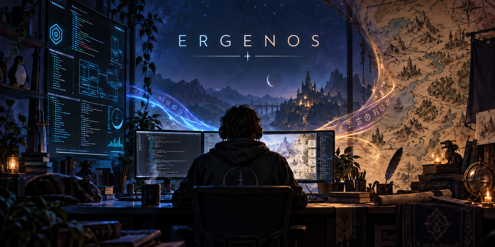
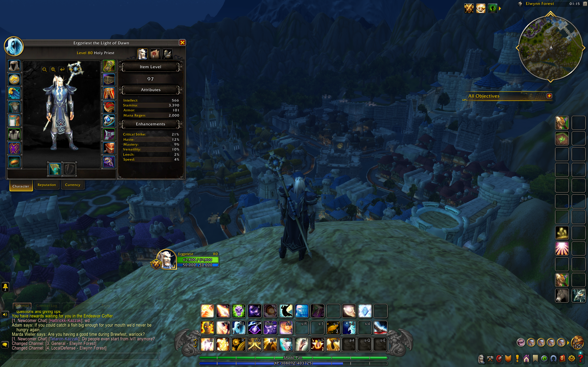

  

## Linux, gaming and the joy of figuring things out

I'm a Linux enthusiast, system tinkerer, lifelong gamer and game playtester from Warsaw. I like taking things apart, understanding why they broke and rebuilding them into something people can actually use.

The name **Ergenos** comes from my wonderfully imperfect attempt at Sindarin: **“Lone Stone Fortress.”** It stuck — first as a nickname, then as the name behind everything I build here.

My main project is **[ErgenOS](https://github.com/ErgenosSW/ErgenOS-Linux)** — an independent Arch Linux based desktop distribution built around GNOME, approachable system management and practical Btrfs recovery.

ErgenOS started as an experiment. It now has a complete graphical installer, its own signed package repository, dedicated desktop applications and a stable **1.2 release** tested beyond the VM.

> Build it. Break it. Recover it. Improve it.

## 🎮 Full-stack gaming milestone

One of the milestones I'm most proud of:

> **World of Warcraft running on my own Linux distribution, through my own custom Proton build.**

The stack behind it:

- 🐧 **ErgenOS Linux** - my Arch-based Linux distribution
- 🍷 **ErgenProton-WoW** - my custom Proton build optimized for World of Warcraft
- 🚀 **Faugus Launcher**
- ⚙️ **UMU**
- ⚔️ **World of Warcraft Retail**

  

This was the first full-stack WoW run where both the operating system and the Proton build were my own projects.

- [ErgenOS Linux](https://github.com/ErgenosSW/ErgenOS-Linux)
- [ErgenProton-WoW](https://github.com/ErgenosSW/ErgenProton-WoW)

## Linux by day, Azeroth by night 🎮

Gaming has always been a major part of who I am. **World of Warcraft** holds a special place in that story, alongside my broader interest in games, hardware, performance and the small details that determine whether an experience feels great or merely works.

Being both a gamer and a playtester shapes the way I build software. I notice rough edges, test unusual scenarios and keep asking what happens when a real person clicks the unexpected button. That perspective also guides my work on Linux gaming: measure first, change one thing at a time and avoid claiming more than the testing supports.

### World of Warcraft projects

| Project | What it does |
|---|---|
| **[ErgenProton-WoW](https://github.com/ErgenosSW/ErgenProton-WoW)** | A focused GE-Proton derivative for Battle.net and World of Warcraft, developed around controlled benchmarks, compatibility testing and a dedicated `umu-wow` profile. |
| **[ManyTongues](https://github.com/ErgenosSW/ManyTongues)** | My continuation of the classic Tongues roleplay addon, bringing languages, gradual fluency, dialects and speech effects to modern World of Warcraft. |

ErgenProton-WoW grew out of practical testing on ErgenOS. Its first optimization produced a measurable improvement in WoW Retail on the tested system, while Retail and Classic Era both completed real gameplay testing successfully. The project stays deliberately conservative: changes should solve a real problem or demonstrate a repeatable benefit.

ManyTongues is a different kind of systems work — built in Lua around chat APIs, compatibility constraints and the wonderfully messy challenge of making roleplay feel more alive. It includes a rebuilt settings window, channel controls and per-player translators while preserving the spirit of the original addon.

*When I'm not rebuilding an Arch-based system or chasing a broken bootloader, you can probably find me somewhere in Azeroth.*

**BattleTag:** `Ergenos#2697`

## Building Lurra — one layer of history at a time 🗺️

Alongside software, I am creating **Lurra**, my original fantasy setting. It is a long-running solo worldbuilding project with its own history, cultures, religions, conflicts, maps and stories — a world meant to feel as if it existed long before any protagonist entered it.

I am currently rebuilding Lurra from the ground up: preserving its strongest ideas while giving the world a more coherent identity, internal logic and independence from the tabletop systems that originally helped shape it.

Lurra is the other side of how I create. ErgenOS is about understanding systems made of code; Lurra is about understanding systems made of people, history, belief and myth.

## The ErgenOS ecosystem

| Project | What it does |
|---|---|
| **[ErgenOS Linux](https://github.com/ErgenosSW/ErgenOS-Linux)** | The distribution, Archiso profile, Calamares installer and system defaults. |
| **[ErgenPac](https://github.com/ErgenosSW/ErgenPac)** | Graphical package manager, system updater and hardware-aware Driver Manager for ErgenOS. |
| **[ErgenCTL](https://github.com/ErgenosSW/ErgenCTL)** | Diagnostics, boot-log inspection, snapshot checks and guided system recovery. |
| **[ErgenOS Welcome](https://github.com/ErgenosSW/ErgenOS-Welcome)** | The first-login starting point with system information and shortcuts to ErgenOS tools. |
| **[ErgenOS Repo](https://github.com/ErgenosSW/ErgenOS-Repo)** | Signed Pacman repository and package-signing keyring for ErgenOS software. |
| **[ErgenOS Secure Boot](https://github.com/ErgenosSW/ErgenOS-SecureBoot)** | Experimental post-install Secure Boot setup using signed shim and a locally enrolled Machine Owner Key. |
| **[ErgenOS Website](https://github.com/ErgenosSW/ErgenOS-Website)** | Official project website, release information and installation documentation. |

## What I work with

  <strong>Systems &amp; infrastructure</strong>

  <strong>Development</strong>

  <strong>Desktop</strong>

## Current direction

- Making Arch-based desktop management understandable without hiding how the system works.
- Building graphical tools that still respect Pacman, Flatpak and standard Linux components.
- Making snapshots and recovery part of normal system maintenance.
- Expanding real-hardware testing and polishing the ErgenOS 1.x experience.
- Developing measurable Linux gaming improvements through ErgenProton-WoW and real-world WoW testing.

## Get involved

ErgenOS is open source and still young. Bug reports, hardware-test results, translations, packaging improvements and code contributions are welcome.

**[Explore ErgenOS](https://ergenossw.github.io/ErgenOS-Website/)** · **[Report an issue](https://github.com/ErgenosSW/ErgenOS-Linux/issues)** · **[Download 1.2](https://ergenossw.github.io/ErgenOS-Website/#download)**

`Your system. Under control.`

